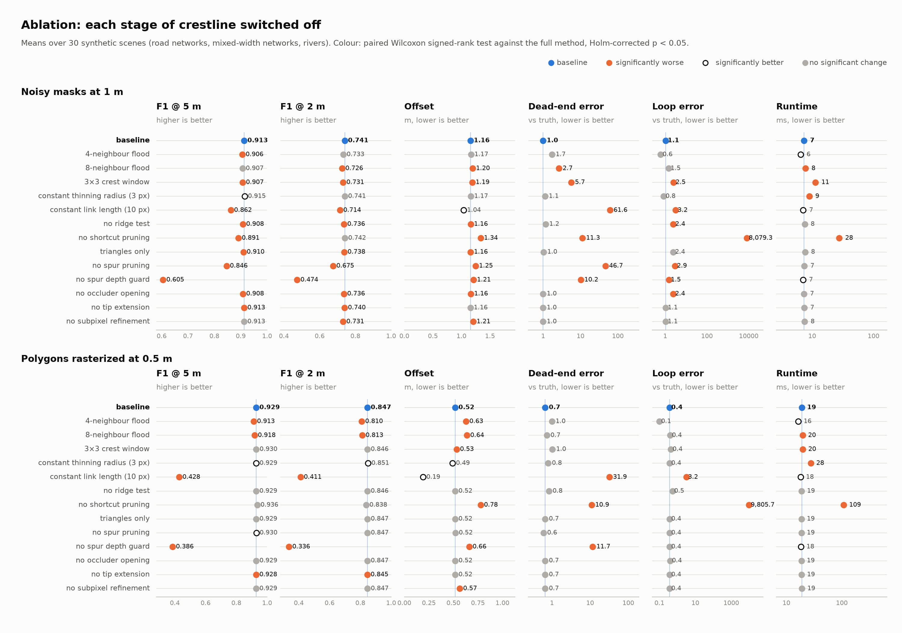
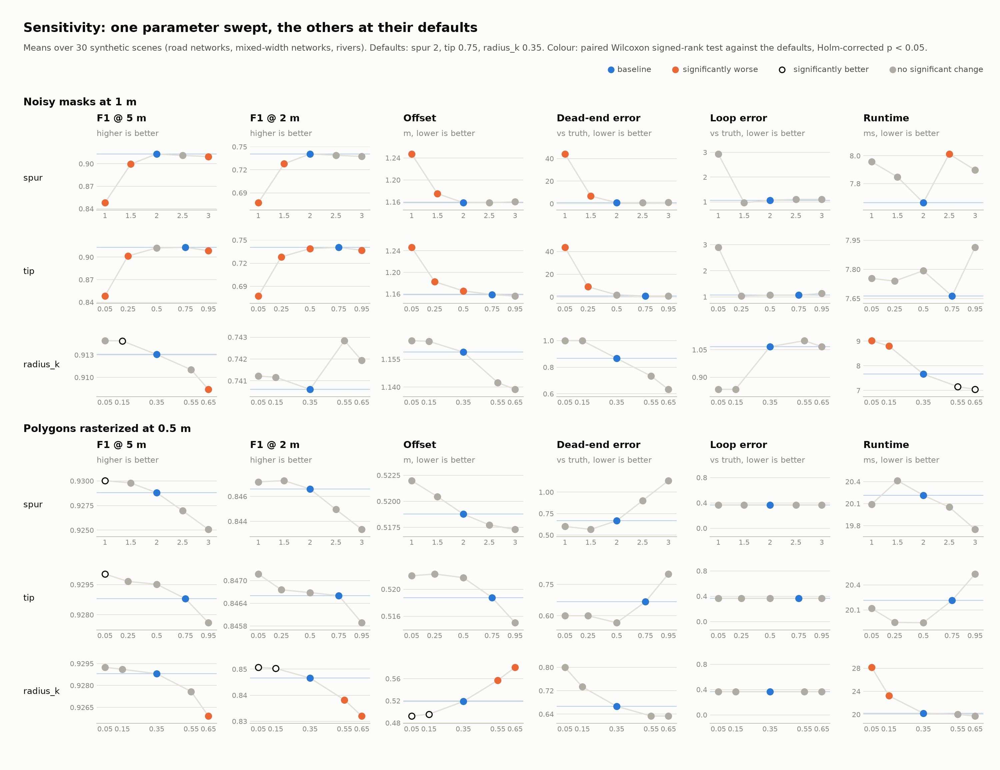

# Crestline

Polygon centerlines by flooding: no skeletonization, linear time, for shapely polygons and raster masks alike.

## Install

```bash
pip install git+https://github.com/giscience/crestline
```

or, from a clone of this repository,

```bash
uv sync
```

On an NVIDIA GPU, pick the extra matching the CUDA version in the `nvidia-smi` header and pass `device='cuda'`. The
flood and the crest then run on the GPU; the result is identical.

```bash
uv sync --extra cu12
uv sync --extra cu13
```

## Usage

```python
import numpy as np
import shapely
from crestline import crestline

road = shapely.LineString([(0, 0), (300, 40), (600, 0)]).buffer(12)
lines = crestline(road, resolution=0.5)

mask = np.zeros((200, 400), bool)
mask[80:120, 20:380] = True
lines = crestline(mask)
```

## How it works

1. **Rasterize** (polygons only). The polygon is burnt into a mask at `resolution` with an even-odd scanline fill at
   pixel centres, so holes and multipart shapes need no special care.
1. **Flood in.** The shape is flooded from its boundary one ring per step, alternating 4- and 8-neighbour steps
   (octagonal distance). A pixel's depth is the number of steps it stays dry; every pixel is visited once.
1. **Crest.** Pixels at least 2 steps deep with nothing deeper in their 5x5 window are the crest: where the flood runs
   out. The narrowest branch that gets a line is 3 px wide.
1. **Link.** Crest pixels are thinned, deepest first, to nodes spaced `max(radius_k * depth, 3)` px apart. Two nodes are
   linked when they are at most twice the deeper depth apart and the depth along the link never drops below
   `dip` times the shallower end (ridge test). The longest link of every triangle or quad is dropped.
1. **Clean.** Dead ends whose disc fits inside `spur` times the disc of a much deeper node (edge noise) are pruned leaf
   by leaf. Dead ends that face each other across a break of the crest are joined when each is the other's nearest
   and the straight line between them stays inside the shape. Loops around holes too small for the depth around them
   (occluders such as cars or tree crowns) are opened.
1. **Refine.** Dead ends are moved to the far end of their crest, every node to the mean of the equally deep crest
   pixels around it (half a pixel on even-width branches), and the links are merged into lines between junctions and
   dead ends.

## Benchmark


Synthetic shapes with known centerlines, as clean polygons (rasterized at 0.5 m) and as noisy masks at 1 m pixels:
- 1 km road networks (15 m half-width),
- 1 km road networks with mixed half-widths (6 to 30 m) and 1 km tapering rivers (5 to 30 m), six seeds each, plus a
  4 km road network (`roads-large`, two seeds).

### CUDA


The same shapes with `device='cuda'` on an NVIDIA RTX 3500 Ada laptop GPU, against the 24-core CPU above.

### Reproduce

```bash
uv sync --extra benchmark --extra cu13
uv run python benchmarks/synthetic_benchmark.py
```

## Real-data benchmark


The Łódź road network in `benchmarks/data` (EPSG:2180): BDOT10k road centerlines are the ground truth, and the road
surface is each centerline buffered by half of its recorded road width (2,836 km of roads, 26.9 km² of surface).
Buffers of 1 to 5 km around the centroid of the centerlines cut out a growing piece of the network.
The method follows the synthetic benchmark.

### Reproduce

```bash
uv sync --extra benchmark
uv run python benchmarks/real_benchmark.py
```

## Ablation



### Reproduce

```bash
uv sync --extra benchmark
uv run python benchmarks/ablation_benchmark.py
```

## Sensitivity



### Reproduce

```bash
uv sync --extra benchmark
uv run python benchmarks/sensitivity_benchmark.py
```

## Reproducing the paper

The CSV files in `benchmarks/output` are the runs behind the paper, made on a 24-core Intel Core i7-13700HX and an
NVIDIA RTX 3500 Ada laptop GPU. The accuracy and topology columns depend only on the seeds; the runtimes depend on the
hardware.

| Paper                      | Script                                         | Source in `benchmarks/output`                                                         |
|----------------------------|------------------------------------------------|---------------------------------------------------------------------------------------|
| Table I (synthetic)        | `synthetic_benchmark.py`                       | `synthetic_benchmark_results.csv`, mean of the `roads`, `mixed` and `river` rows       |
| Table II (real data)       | `real_benchmark.py`                            | `real_benchmark_results.csv`, rows with `radius_km` = 5                               |
| Runtime                    | `synthetic_benchmark.py`, `real_benchmark.py`  | `runtime_ms` of both files, including `roads-large` and every buffer                   |
| Table III (ablation)       | `ablation_benchmark.py`                        | `ablation_benchmark_results.csv` (10 seeds, 30 scenes)                                 |
| Sensitivity analysis       | `sensitivity_benchmark.py`                     | `sensitivity_benchmark_results.csv` (125 variants, 7,500 runs)                         |
| Figures 1-4                | `paper/*_plot.py`                              | `paper/*.png`                                                                         |

## Limitations

Disjoint parts of a shape are processed independently with no bridging of the gaps between them.
Each resulting line ends about one local half-width before the gap, so occlusions and segmentation dropouts that cut a branch leave the network with breaks unless post-processing joins the dead ends.
Occluders that only make a hole into a branch are handled by opening the loop around them.

## Background

Crestline combines established ideas:

- Blum's grassfire transform (https://en.wikipedia.org/wiki/Grassfire_transform),
- Digital distance transforms (Rosenfeld & Pfaltz, 1968).

What it adds is a skeletonization-free pipeline whose linking and pruning rules scale with the local depth, with
linear-time raster stages, that works on both vectors and rasters.

## AI Assistance

Claude Opus 5.5 was used to handle refactoring and code improvement in this project.
Its involvement is limited to the `benchmarks` and `tests` code.
The rest of the codebase is 100% hand-crafted by humans, so any mistakes in it are fully organic (drop an issue if you spot one :)
