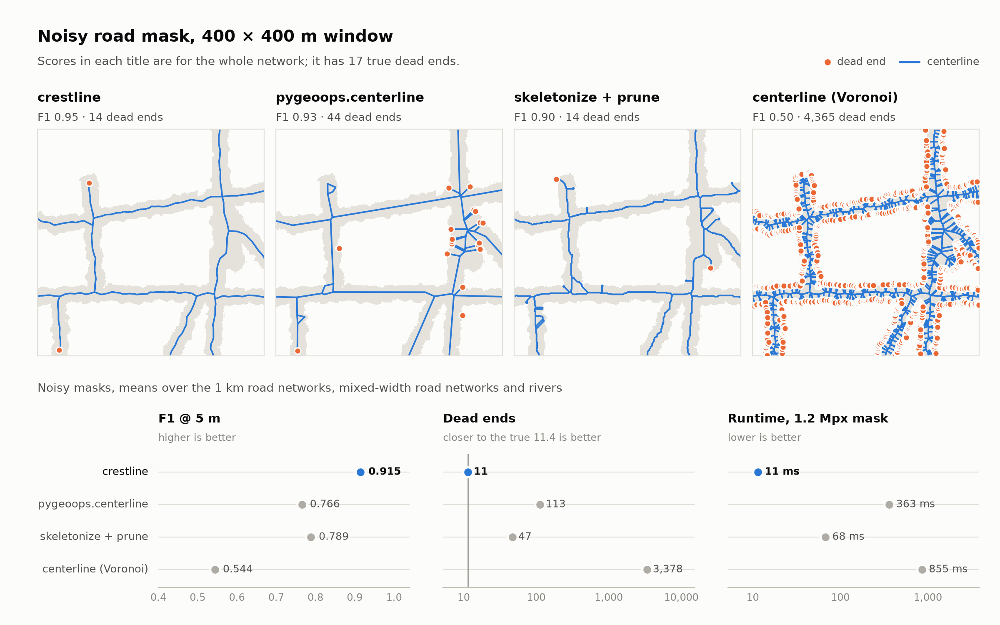
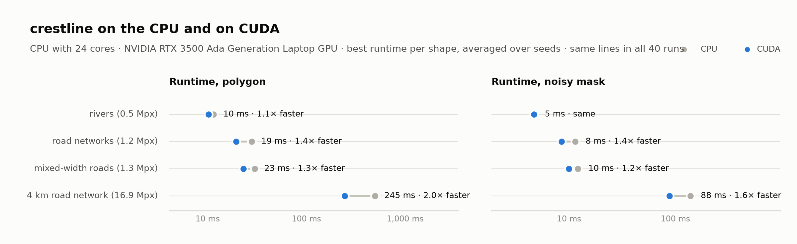
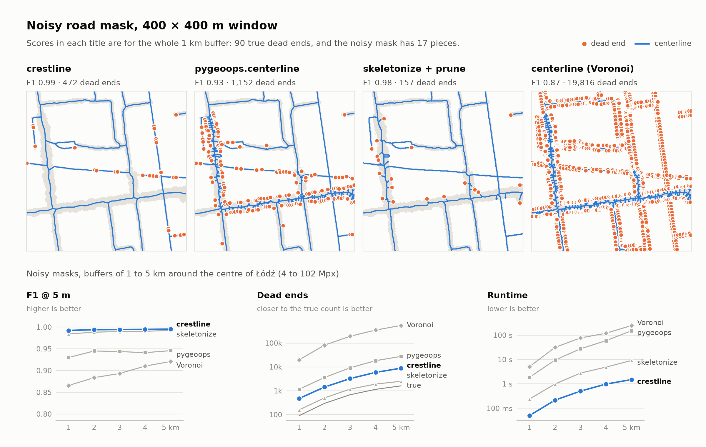

# Crestline

Polygon centerlines by flooding: no skeletonization, linear time, for shapely polygons and raster masks alike.

## Install

```bash
uv sync
```

On an NVIDIA GPU, pick the extra matching the CUDA version in the `nvidia-smi` header and pass `device='cuda'`. The
flood and the crest then run on the GPU; the result is identical.

```bash
uv sync --extra cu12
uv sync --extra cu13
```

## How it works

1. **Flood in.** The shape is flooded from its boundary one ring per step. A pixel's depth is the number of steps it
   stays dry.
1. **Crest.** Pixels with nothing deeper within 2 px are the crest: where the flood runs out.
1. **Flood out.** A second flood runs back from the crest, staying inside the shape. `climb / (climb + to_go)` gives a
   0 → 1 center raster that peaks along the middle of every branch, whatever its width. Its peaks are exactly the crest
   pixels at least 2 steps deep, so the vector pipeline reads them straight from step 2.
1. **Link.** Crest points are thinned and linked along the ridges, both scaled by each point's own depth, so narrow and
   wide branches are treated alike. The longest link of every triangle or quad is dropped, and dead ends whose disc fits
   inside the disc of a much deeper point (edge noise) are pruned.

## Benchmark



Synthetic shapes with known centerlines at 1 m pixels:
- 1 km road networks (15 m half-width),
- 1 km road networks with  mixed half-widths (6 to 30 m) and 1 km tapering rivers (5 to 30 m), six seeds each, plus a 4 km road network.

### CUDA



The same shapes with `device='cuda'` on an NVIDIA RTX 3500 Ada laptop GPU, against the 24-core CPU above.

### Reproduce

```bash
uv sync --extra benchmark --extra cu13
uv run python benchmarks/synthetic_benchmark.py
```

## Real-data benchmark



The Łódź road network in `benchmarks/data` (EPSG:2180): BDOT10k road centerlines are the ground truth, and the road
surface is each centerline buffered by its real road width (2,836 km of roads, 24.7 km² of surface).
Buffers of 1 to 6 km around the centroid of the centerlines cut out a growing piece of the network.
The method follows the synthetic benchmark.

### Reproduce

```bash
uv sync --extra benchmark
uv run python benchmarks/real_benchmark.py
```

The summary table is rewritten after every buffer, so `--plot_only` can redraw the figure from a partial run. The
largest buffers need plenty of memory: the noise and the skeleton baseline each hold several full-size distance
transforms.

## Limitations

TBD

## Background

Crestline combines established ideas:

- Blum's grassfire transform (https://en.wikipedia.org/wiki/Grassfire_transform),
- Digital distance transforms (Rosenfeld & Pfaltz, 1968),
- Boundary-to-skeleton ratio field like the skeleton-aware distance transform of Lin et al. (MICCAI 2023).

What it adds is a skeletonization-free, linear-time pipeline that normalises inside the shape and works on both vectors
and rasters.
